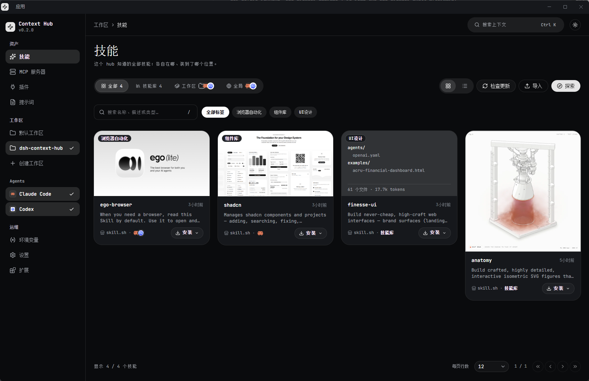
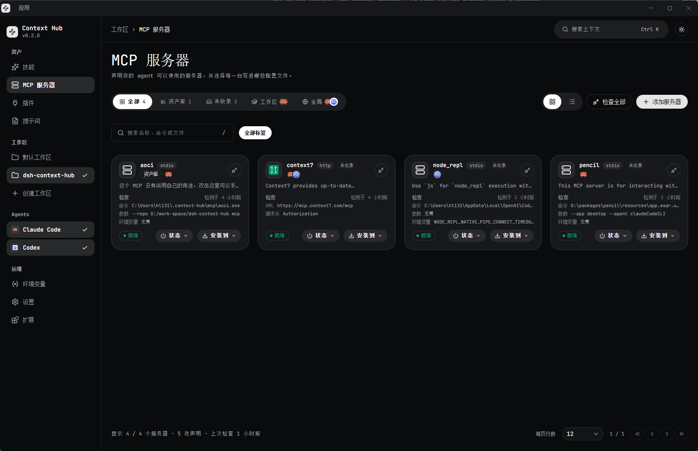
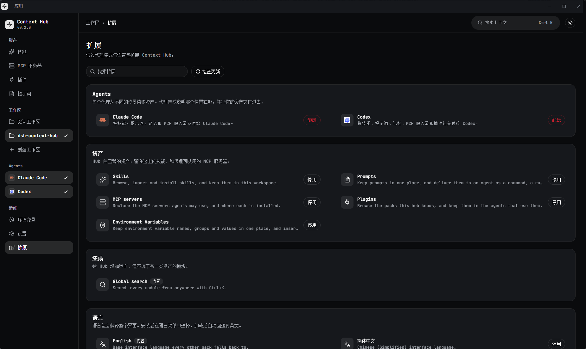

<div align="center">


# Context Hub

**一站式管理你的 AI 编程 Agent 所需的一切。**

Context Hub 把技能、MCP 服务器、插件、提示词和环境变量收在一处，再投递到各个 Agent 自己的工作区或全局目录。它可以是桌面应用、独立 CLI，也可以是一个本地网页。

[](#功能)
[](#功能)
[](#功能)
[](#功能)
[](#安装)
[](#开发)
[](https://github.com/bb-boy680/context-hub/releases/latest)

[English](README.md) · [简体中文](README.zh-CN.md)



</div>

---

## 为什么需要 Context Hub？

每个 Agent 都把自己的资产放在自己的位置：技能在工作区目录，MCP 服务器在 JSON 配置里，提示词在 commands 目录，环境变量在 shell profile 中。再加一个 Agent，同一份资产就要维护两遍。

Context Hub 给这些资产一个统一的目录和一套安装流程，同时仍然把文件留在 Agent 期望的位置。

## 截图

| MCP 服务器 | 扩展 |
| --- | --- |
|  |  |

## 功能

- **一套库，管理所有资产** — 技能、MCP 服务器、插件、提示词和环境变量，统一在同一个工作区目录中管理。
- **直接投递到每个 Agent** — Claude Code 和 Codex 集成会把每份资产安装到该 Agent 自己的工作区或全局目录；更多 Agent 通过插件接入。
- **一次声明，多端可用** — MCP 服务器和提示词会写入各 Agent 自己的配置，并可按客户端单独启用或停用。
- **桌面端、CLI 或浏览器** — 同一个本地 hub 支撑 Electron 应用、独立二进制和构建后的网页。
- **可扩展** — Agent 集成、资产模块、搜索提供方、设置区块和语言包都是插件。
- **全局搜索** — 按 `Ctrl/Cmd+K`，在任意页面搜索所有模块。
- **保持最新** — 技能和插件包会跟踪上游来源；桌面端可从 GitHub Releases 自动更新。
- **本地优先，中英双语** — 资产留在 Agent 自己的目录里，界面支持英文和简体中文。

## 安装

### 桌面应用

从 [Releases](https://github.com/bb-boy680/context-hub/releases/latest) 下载最新版本：

| 平台 | 文件 |
| --- | --- |
| Windows x64 | `Context-Hub-<version>-win-x64.exe` |
| macOS（Apple Silicon） | `Context-Hub-<version>-mac-arm64.dmg` |
| Linux x64 | `Context-Hub-<version>-linux-x86_64.AppImage` |

> [!NOTE]
> 构建产物没有代码签名。Windows SmartScreen 和 macOS Gatekeeper 会在首次启动时给出警告。macOS 目前只提供 arm64 版本。

### 独立 CLI

每个二进制都内嵌了 hub 和页面，因此不需要 Node.js 或 `npm install`：

| 平台 | 文件 |
| --- | --- |
| Windows x64 | `context-hub-windows-x64.exe` |
| Linux x64 / arm64 | `context-hub-linux-x64`, `context-hub-linux-arm64` |
| macOS Apple Silicon / Intel | `context-hub-darwin-arm64`, `context-hub-darwin-x64` |

运行后打开它打印的地址：

```bash
./context-hub-linux-x64
# context hub server listening on http://127.0.0.1:...
```

CLI 支持 `--port`、`--host`、`--folder`、`--home` 和 `--static`；完整列表运行 `--help` 查看。

### 从源码运行

需要 Node.js 20 或更高版本，以及 pnpm `10.33.4`。

```bash
pnpm install
pnpm dev          # 同时启动 web 和桌面端
pnpm dev:web      # 只启动浏览器形态
pnpm dev:desktop  # 只启动桌面端
```

## 使用

1. **在侧栏选择 Agent**。只有选中的 Agent 会被读取和写入。
2. **添加工作区** — 你正在开发的项目目录。hub 会读取其中每个 Agent 的工作区目录。
3. **添加资产** — 从文件夹或插件提供的注册表导入技能，添加 MCP 服务器，安装插件包，编写提示词，或记录环境变量。
4. **安装到位置** — 技能、MCP 服务器、插件和提示词都可以投递到工作区或 Agent 的全局目录。

> [!TIP]
> 按 `Ctrl/Cmd+K` 可以在当前页面直接搜索技能、服务器、插件包、提示词和环境变量。
>
> hub 的库默认保存在 `~/.context-hub`，设置 `CONTEXT_HUB_HOME` 可以换一个目录。

## 支持的 Agent

- **Claude Code** — 技能、提示词、MCP 服务器和插件包。
- **Codex** — 技能、提示词、MCP 服务器和插件包。
- **更多 Agent** — 通过 [Context Hub 扩展市场](https://github.com/bb-boy680/context-hub-extensions) 安装。

## 开发

```bash
pnpm dev                  # 同时启动 web 和桌面端，带 HMR
pnpm build                # 构建所有包（页面 + 桌面端 bundle）
pnpm --filter web start   # 启动构建后的页面
pnpm build:cli            # 构建五个平台的 CLI（需要 bun）
pnpm build:desktop        # 打包桌面端 main 与 preload 进程
pnpm test                 # 在同一个进程里跑所有包的测试
pnpm lint                 # ESLint
pnpm typecheck            # 全工作区 tsc
```

桌面安装包按平台构建：

```bash
pnpm --filter @context-hub/desktop package:win
pnpm --filter @context-hub/desktop package:mac
pnpm --filter @context-hub/desktop package:linux
```

测试会写入真实文件、启动真实 HTTP 监听、拉起真实 MCP 服务器；其中一个更新测试还会 clone git 仓库，所以 `git` 必须在 PATH 上。

内核基于 Cordis；界面使用 React 19、Vite、Tailwind CSS 和 shadcn/ui。

## 文档

- [构建分发包](docs/building.md) — CLI、桌面端、发布版本号，以及本地能验证到什么程度。
- [扩展](docs/extensions.md) — 扩展布局、市场索引、本地开发来源和信任模型。
- [发布](docs/releasing.md) — 发布流程，中文图文。
