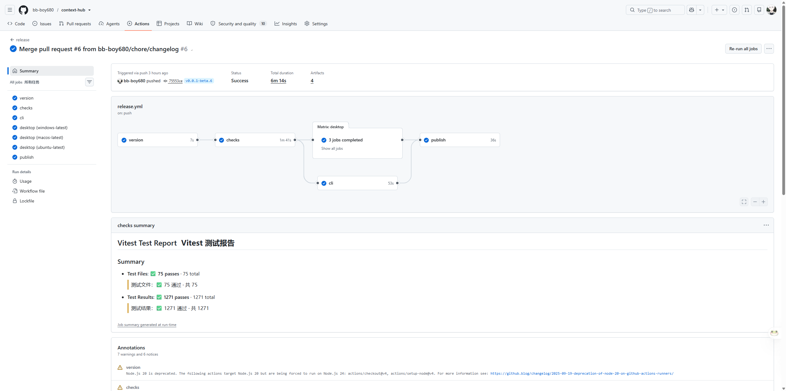
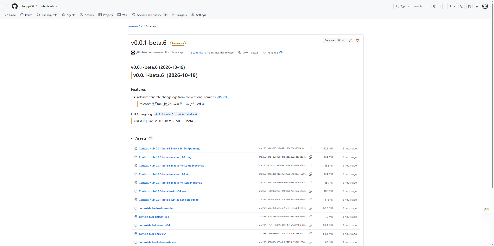
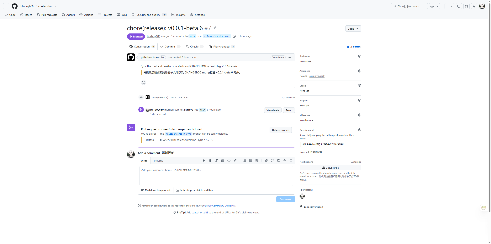
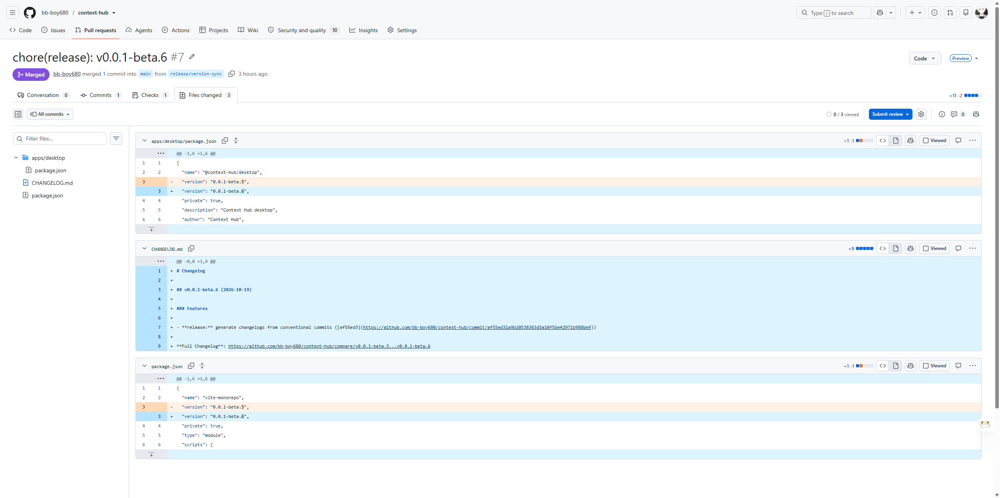

# 发版指南

Context Hub 用 **tag 发版**。推一个 `v<version>` tag 后，GitHub Actions 会自动检查、构建 CLI 和桌面端、发布 GitHub Release，并创建一个版本同步 PR。

合并 main 不会发版；main 已受保护，所有代码改动必须通过 PR。

## 1. 确定版本号

| 类型 | tag 示例 | 结果 |
|---|---|---|
| 测试版 | `v0.2.0-beta.1` | GitHub Release 标记为 **Pre-release**，正式用户的自动更新不会收到 |
| 正式版 | `v0.2.0` | 普通 Release |
| 大版本 | `v2.0.0` | 普通 Release，主版本号 +1 |

tag 规则：

- 必须以 `v` 开头：`v1.2.3`
- 必须是严格 semver：`v1.2.3`、`v1.2.3-beta.1`
- `v1.2`、`vfoo` 会被 workflow 拒绝
- tag 就是发布版本，**不需要先改 `package.json`**；构建时会把 tag 版本注入两处 manifest

## 2. 打 tag 并推送

```sh
git switch main
git pull

git tag -a v0.2.0-beta.1 -m "v0.2.0-beta.1"
git push origin v0.2.0-beta.1
```

只需要推 tag。不要尝试直接 push main，main 受保护会拒绝。

## 3. 看 Actions 运行

打开仓库的 **Actions → release**，或直接打开 tag 对应的 run。



流程依次是：

1. **version**：解析 tag，得到发布版本和是否为测试版
2. **checks**：lint、typecheck、test、build
3. **cli**：构建 5 个平台的 CLI 二进制
4. **desktop**：Windows / macOS / Linux 三个 runner 各自打包
5. **publish**：创建 Release、上传资产、创建版本同步 PR

任何一个 job 失败都不会发布。构建失败时用 **Re-run failed jobs** 重跑，不要删除或移动 tag。

## 4. 检查 Release

打开 **Releases** 页面，点对应 tag。



确认：

- 测试版有 **Pre-release** 标记
- Changelog 按 **Features / Bug Fixes / Breaking Changes** 等分组，每条带 commit 链接
- 资产包含：
  - Windows：`.exe`、`latest.yml`、`.blockmap`
  - macOS：`.dmg`、`.zip`、`latest-mac.yml`、`.blockmap`
  - Linux：`.AppImage`、`latest-linux.yml`、`.blockmap`
  - 5 个 CLI 二进制：Windows x64、Linux x64/arm64、macOS arm64/x64

## 5. 合并版本同步 PR

发布成功后，`github-actions[bot]` 会自动创建一个 PR：

```text
chore(release): vX.Y.Z
```



它只改三个文件：



- `package.json`
- `apps/desktop/package.json`
- `CHANGELOG.md`

操作步骤：

1. 打开这个 PR
2. 如果显示 **This workflow requires approval from a maintainer**，点 **Approve workflows to run**
3. 等 `checks` 通过
4. 点 **Merge pull request**

GitHub 对 `GITHUB_TOKEN` 创建的 PR 有安全限制，所以这一步需要人工批准一次。合并后，main 上的版本号才和已发布的 tag 一致。

## 6. 常见问题

### 合并 main 会自动发版吗？

不会。只有推 `v*` tag 才会触发 release workflow。

### 打 tag 前要改 `package.json` 吗？

不需要。构建 job 会把 tag 版本写入根和 `apps/desktop/package.json`，发布后由版本同步 PR 回写仓库。

### 版本同步 PR 的 checks 一直不运行？

点 PR 页面里的 **Approve workflows to run**。这是 GitHub 对 bot 创建 PR 的安全机制，不是 CI 配置问题。

### 构建失败了怎么办？

打开失败的 run，点 **Re-run failed jobs**。tag 保留，不要删除或移动。发布成功之前不会创建版本同步 PR。

### 测试版会不会推给正式用户？

不会。版本里含 `-` 时创建的是 GitHub Pre-release；`electron-updater` 当前 `allowPrerelease = false`，只检查普通 Release。

### 安装包有安全警告怎么办？

当前没有代码签名。Windows SmartScreen 和 macOS Gatekeeper 会警告；macOS 目前只产出 arm64 包。正式分发前需要配置签名和公证。

### 私有仓库能自动更新吗？

不能。私有仓库的 Release 资产只对协作者可见，桌面端匿名的 `electron-updater` 检查无法访问。公开分发需要公开仓库或另找分发渠道。

### 想撤销一个版本？

删除 tag 或 Release 属于破坏性操作。先确认没有用户安装该版本，再手动处理；不要在 workflow 里自动删除或移动 tag。

## 命令速查

```sh
# 测试版
git tag -a v0.2.0-beta.1 -m "v0.2.0-beta.1"
git push origin v0.2.0-beta.1

# 正式版
git tag -a v0.2.0 -m "v0.2.0"
git push origin v0.2.0

# 大版本
git tag -a v2.0.0 -m "v2.0.0"
git push origin v2.0.0
```
